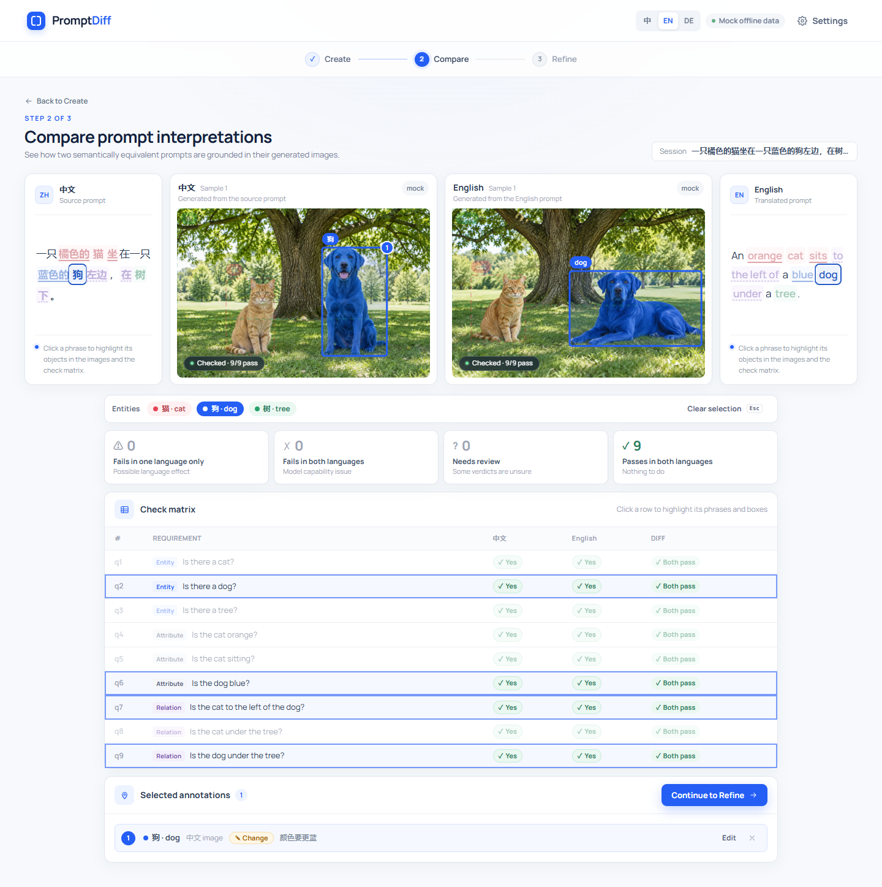
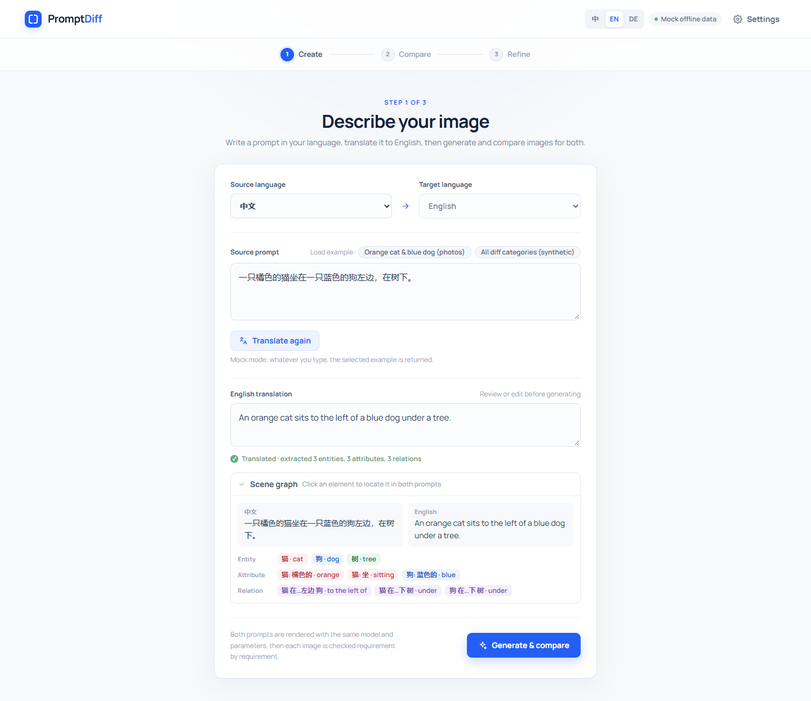
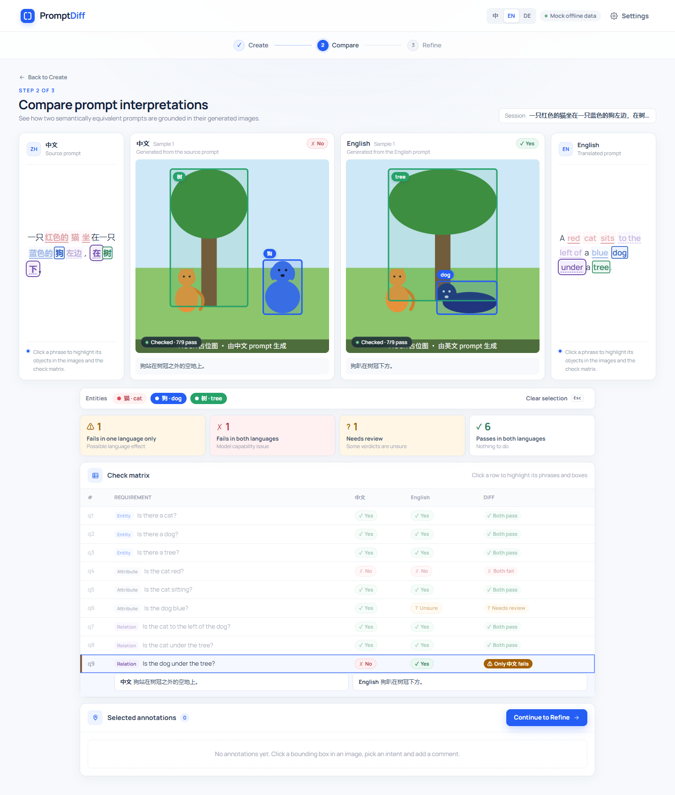

# PromptDiff

[中文](README.md) · **English**

**Visualize how a multilingual prompt and its generated images differ.**

Write a prompt in your own language, translate it into English, generate an image from each version, and check every image requirement by requirement.
PromptDiff links the prompt text, the scene graph and the images, so you can see at a glance which requirement fails in only one language. You can also annotate regions of an image as input for refining it.

Course project for “Practical Information Visualization” at LMU Munich (WS 2026/27). Frontend only, no backend.



---

## Getting started

Requires Node.js 22.12 or later (required by Vitest; developed on 24).

```bash
npm install
npm run dev        # open http://localhost:5173
```

By default the app runs in **Mock mode**: no network and no API key needed. It reads example data from `fixtures/`, which makes it suitable for offline demos.

| Command | Purpose |
| --- | --- |
| `npm run dev` | Development server (<http://localhost:5173>) |
| `npm run build` | Type check + production build into `dist/` |
| `npm run preview` | Preview the production build locally |
| `npm test` | Vitest unit tests |

> **Windows note:** run `npm test` from a path with an upper-case drive letter (e.g. `D:\Claude\PIV`). From a lower-case `d:\` path, Vitest loads its modules twice and fails with “failed to find the current suite”. `dev` and `build` are not affected.

---

## How it works

### ① Create

1. Pick the source language (中文, Deutsch, 日本語, …) and write a prompt, or click **Load example**.
2. Click **Translate & extract**. You get an editable English translation and a bilingual scene graph (entities, attributes and relations, with the same IDs in both languages). Clicking an element of the scene graph highlights the matching phrases in both prompts.
3. Click **Generate & compare**. Both prompts are rendered with the same model and parameters, and each image is then checked requirement by requirement.



### ② Compare

- **Four-column workspace:** source prompt | image from the source prompt | image from the English prompt | English prompt. Phrases are colored by entity, and bounding boxes are drawn on the images.
- **Linked highlighting:** clicking a phrase, a bounding box or a row of the check matrix highlights the related items in all three places. Press Esc to clear the selection.
- **Diff overview:** counts requirements per category: fails in one language only, fails in both, needs review, passes in both.
- **Check matrix:** rows are requirements, columns are images. Each cell uses an icon, a color and a label together (✓ Yes / ✗ No / ? Unsure / – N/A). Rows that fail in only one language are highlighted in amber.
- **Annotations:** click a bounding box, choose an intent (keep appearance / keep position / change / remove) and add a comment. Annotations are numbered automatically and listed at the bottom of the page.



### ③ Refine

Lists the annotations carried over from the Compare step. Turning annotations into an edit instruction and generating a refined image is still in development (see *Feature status* below).

---

## Using Gemini

1. Create an API key in [Google AI Studio](https://aistudio.google.com/apikey).
2. Open **Settings** (top right), select **Gemini** and paste the key. Change the model IDs if needed.
   - Defaults: `gemini-3.5-flash` for text and vision, `gemini-3.1-flash-image` for images. Use the models that are available to your account in AI Studio.
3. Go back to the **Create** step and use the app as usual.

Notes:

- The key is **stored only in this browser’s localStorage**. Requests go straight from the browser to Google; the key never appears in the code, the fixtures or the repository. Do not save it on a shared computer.
- Image models may have no quota on the free tier. On a 429 error the app shows which model and which limit were hit, together with Google’s original message. When a retry makes sense, it retries automatically after the delay Google suggests (at most twice).
- The Gemini SDK is loaded on demand, so Mock mode never downloads it.

---

## Interface language

Switch between **中文 / English / Deutsch** in the top bar. The choice is saved in the browser; on the first visit the browser’s language is used.

- The interface language is independent of the prompt’s source language.
- Prompts, scene graphs, check questions and the verdict reasons stored in the examples are data, so they are not translated.
- With Gemini, verdict reasons are written in the current interface language.

---

## Pipeline

| Step | What happens | Where |
| --- | --- | --- |
| ① Native input | Pick the source language, write the prompt | Frontend |
| ② Translate + extract | One call: English translation + bilingual scene graph + check questions | Text model |
| ③ Generate two sets | Same model and parameters, N images per language | Image model |
| ④ Check | One call per image: yes / no / unsure + reason + entity bounding boxes | Vision model |
| ⑤ Diff | Check matrix + diff categories | Frontend (`src/lib/diff.ts`) |
| ⑥ Linked views + annotation | Prompt · scene graph · image linked; select regions and state an intent | Frontend |
| ⑦ Edit instruction | Annotations + text → edit instruction | Text model (in development) |
| ⑧ Refined image | Image editing with both sets as references, then back to ④ | Image model (in development) |

Key design decisions:

- **Questions depend on each other** (following DSG): first ask whether an entity exists, then ask about its attributes and relations. If a parent requirement is *no*, its children are recorded as `n/a`.
- **Diff categories:** each requirement is classified from the results in both languages as `both_pass`, `both_fail`, `src_only_fail`, `en_only_fail` or `uncertain`. With several images per language, the pass rate is used with a threshold of 0.5. A user correction takes precedence over the model’s verdict.
- **Character offsets are computed in code:** the model only returns phrases copied from the prompt, and the frontend locates them, because LLMs are unreliable at counting characters.
- **Structured output, checked twice:** JSON returned by the LLM is constrained by a JSON schema and then validated with zod, with one retry on failure.
- **One coordinate convention:** inside the app, bounding boxes are always normalized `[x0, y0, x1, y1]` (0–1). Gemini’s `[ymin, xmin, ymax, xmax]` (0–1000) is converted exactly once, inside GeminiProvider.
- **Reproducibility:** every generated image records the model ID, parameters, the prompt actually sent, the prompt template version and the time.

Full requirements (F1–F17) are in [docs/SPEC.md](docs/SPEC.md) (in Chinese).

---

## Feature status

Requirement IDs from [docs/SPEC.md](docs/SPEC.md):

| ID | Requirement | Status |
| --- | --- | --- |
| F1 | Choose a source language and write a prompt | ✅ |
| F2 | Editable English translation; show back-translation | ✅ editable translation · ⬜ back-translation |
| F3 | Extract a bilingual scene graph in one call | ✅ |
| F4 | Warn about translation drift before generating | ⬜ |
| F5 | N images per language | ✅ N = 1 · ⬜ adjustable N |
| F6 | Per-requirement verdict + reason + bounding boxes | ✅ |
| F7 | Linked prompt / graph / image regions | ✅ |
| F8 | Check matrix highlighting single-language failures | ✅ |
| F9 | Scene graph node view colored by results; user corrections | ⬜ node view not built yet (prompt phrases are colored by entity) |
| F10 | Annotate by clicking a box: intent + comment + number | ✅ |
| F11 | Freehand region selection | ⬜ |
| F12 | Edit instruction from annotations, refined image | ⬜ |
| F13 | Re-check the refined image, show improvements / regressions | ⬜ |
| F14 | Iteration tree + IndexedDB persistence | ⬜ data currently lives in memory and is lost on reload |
| F15 | Settings: API key, model IDs, N, image size, Mock switch | ✅ except N |
| F16 | Preset examples; session import / export | ✅ presets · ⬜ import / export |
| F17 | Baseline mode, timing, event log | ⬜ |

Also done: a multilingual interface (中文 / English / Deutsch) and a visual design based on the team’s prototype.

---

## Example data (fixtures)

Choose an example under **Load example** on the Create step:

| Example | Description |
| --- | --- |
| **Orange cat & blue dog (photos)** `fixtures/cat-dog/` | Two real generated images (1536×1024). Prompt: “一只橘色的猫坐在一只蓝色的狗左边，在树下。” (“An orange cat sits to the left of a blue dog under a tree.”) All 9 requirements pass in both languages. Bounding boxes were estimated by hand. |
| **All diff categories (synthetic)** `fixtures/cat-dog-svg/` | Hand-drawn SVG placeholders with a “red cat” prompt. The check results deliberately cover every diff category, which is useful for development and for demonstrating language differences. |

The data follows the `Session` type in `src/types.ts`; see [fixtures/README.md](fixtures/README.md) (in Chinese).

---

## Project structure

```text
docs/SPEC.md            Requirements, pipeline, diff categories
docs/images/            README screenshots (en/ for this file)
fixtures/               Session JSON and images for Mock mode and offline demos
src/
  types.ts              Shared data types (Session / SceneGraph / Check / Annotation …)
  index.css             Design tokens (Tailwind @theme) and shared utility classes
  i18n/                 Interface text: zh.ts (base), en.ts, de.ts
  ai/
    provider.ts         AIProvider interface
    mock.ts             MockProvider (reads fixtures)
    gemini.ts           GeminiProvider (structured output, zod validation, 429 retries, coordinate conversion)
    schema.ts           zod schema for Session
    prompts/            Versioned prompt templates (extract.v1, verify.v2, generate.v1)
  lib/
    diff.ts             Diff classification
    geometry.ts         Coordinate conversion
    graph.ts            Linked-highlight queries, prompt segmentation
    pipeline.ts         Phrase location, question dependencies, n/a propagation
    annotations.ts      Adding/removing annotations and numbering
  store/                Zustand: session state (selectedId drives linking), settings (persisted)
  components/           Shared components, icons, stepper, entity colors, language switch
  features/             create / compare / annotate / refine / settings
```

**Tech stack:** Vite · React 19 · TypeScript (strict) · Tailwind CSS 4 · Zustand · zod · @google/genai · Vitest

---

## Tests

```bash
npm test
```

All pure functions in `src/lib/` have unit tests: diff classification, coordinate conversion, phrase location, question dependencies, annotation numbering and linked-highlight queries. GeminiProvider is tested with an injected fake client, covering structured output, validation retries, 429 handling, sequential requests and localized error messages. An i18n test checks that the three dictionaries have identical keys and parameters.

---

## Contributing

Development conventions:

- All AI calls go through a provider in `src/ai/`; components never call an SDK directly.
- No hard-coded interface text in components: add it to `src/i18n/zh.ts` first, then to `en.ts` and `de.ts`.
- Languages are identified as `src` / `en` / `refined`. The interface shows language names, never “A / B”.
- Verdicts must never rely on color alone; always show the ✓ / ✗ / ? icons as well.
- To change a prompt template, add a new version file (e.g. `verify.v3.ts`) instead of editing an old one.
- Run `npm run build` after every change; changes in `src/lib/` also need tests and a passing `npm test`.
- Never put an API key in code or fixtures, or commit one to the repository.
