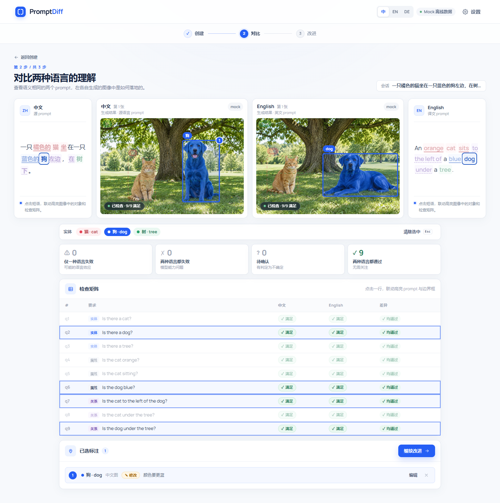
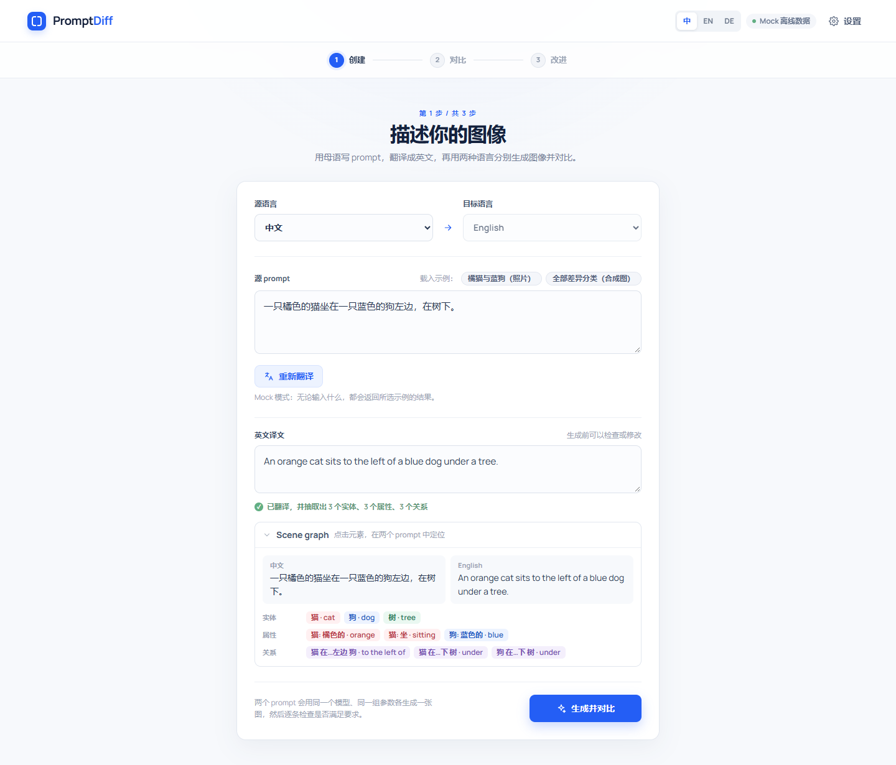
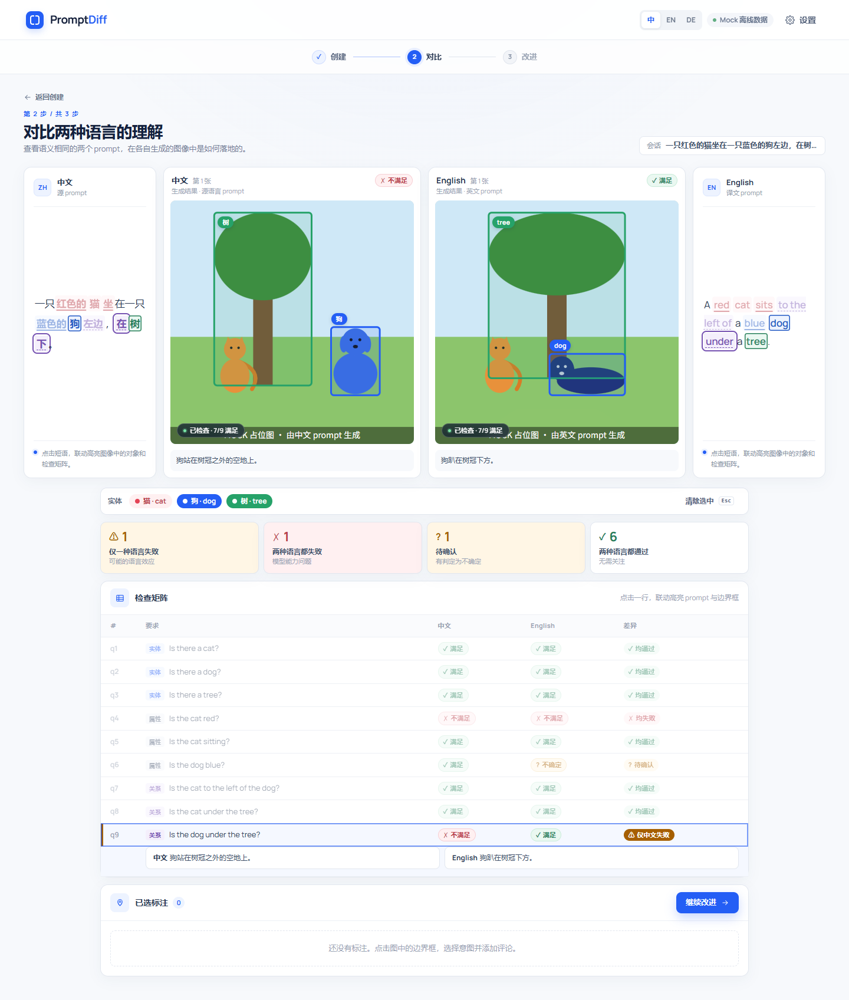

# PromptDiff

**中文** · [English](README.en.md)

**可视化「多语言 prompt」与「生成图像」之间的差异。**

用母语写一段 prompt，翻译成英文，用两种语言分别生成图像，再逐条检查每张图是否满足 prompt 中的要求。
PromptDiff 把 prompt 文本、scene graph 和图像三处联动起来，让你一眼看出「哪条要求只在一种语言里失败了」，并可以在图上圈选标注，作为改进图像的依据。

LMU「Practical Information Visualization」课程项目（WS 2026/27）。纯前端应用，无后端。



---

## 快速开始

需要 Node.js 22.12 或更高版本（Vitest 的要求；开发时使用 24）。

```bash
npm install
npm run dev        # 打开 http://localhost:5173
```

默认使用 **Mock 模式**：不联网、不需要 API key，直接读取 `fixtures/` 里的示例数据，适合离线演示。

| 命令 | 作用 |
| --- | --- |
| `npm run dev` | 开发服务器（<http://localhost:5173>） |
| `npm run build` | 类型检查 + 生产构建，输出到 `dist/` |
| `npm run preview` | 本地预览构建结果 |
| `npm test` | Vitest 单元测试 |

> **Windows 注意**：请在大写盘符路径下运行 `npm test`（如 `D:\Claude\PIV`）。在小写 `d:\` 路径下，vitest 会加载两份模块并报错 "failed to find the current suite"。`dev` 和 `build` 不受影响。

---

## 使用流程

### ① 创建

1. 选择源语言（中文、Deutsch、日本語等），输入母语 prompt；也可以点「载入示例」。
2. 点「翻译并抽取」：得到可编辑的英文译文，以及双语 scene graph（实体 / 属性 / 关系，两种语言共用 ID）。点击 scene graph 中的元素，会在两段 prompt 里高亮对应短语。
3. 点「生成并对比」：用同一个模型、同一组参数为两个 prompt 各生成一张图，再逐条检查。



### ② 对比

- **四栏工作区**：源语言 prompt ｜ 源语言生成图 ｜ 英文生成图 ｜ 英文 prompt。短语按实体着色，图上叠加边界框。
- **三处联动**：点击 prompt 中的短语、图上的边界框或检查矩阵的一行，三处同步高亮。按 Esc 清除选中。
- **差异概览**：按要求统计四类结果，即仅一种语言失败、两种语言都失败、待确认、两种语言都通过。
- **检查矩阵**：行是要求，列是图像，单元格同时用图标、颜色和文字表示（✓ 满足 / ✗ 不满足 / ? 不确定 / – 不适用）。只在一种语言里失败的行会用琥珀色突出。
- **标注**：点击边界框，选择意图（保留外观 / 保留位置 / 修改 / 删除）并写评论，标注会自动编号，列在页面底部。



### ③ 改进

列出从对比页带过来的标注。根据标注合成编辑指令、生成改进图的功能尚在开发中（见下方「功能状态」）。

---

## 使用 Gemini

1. 在 [Google AI Studio](https://aistudio.google.com/apikey) 申请 API key。
2. 打开右上角「设置」，选择 **Gemini**，粘贴 key；如有需要，修改模型 ID。
   - 默认的文本 / 视觉模型是 `gemini-3.5-flash`，图像模型是 `gemini-3.1-flash-image`。请以 AI Studio 中你的账号可用的模型为准。
3. 回到「创建」页正常使用即可。

说明：

- key **只保存在本浏览器的 localStorage 中**，请求从浏览器直接发往 Google；代码、fixture 和仓库中都不包含 key。请勿在公用电脑上保存 key。
- 图像模型在免费层可能没有额度。遇到 429 错误时，界面会显示是哪个模型、哪种限额，以及 Google 的原始说明；可以重试的情况会按 Google 建议的等待时间自动重试（最多 2 次）。
- Gemini SDK 按需加载，Mock 模式不会下载它。

---

## 界面语言

右上角可在 **中文 / English / Deutsch** 之间切换，选择保存在浏览器中。首次打开时，会根据浏览器语言自动选择。

- 界面语言与 prompt 的源语言无关。
- prompt、scene graph、检查问题和示例中的判定理由属于数据，不随界面语言翻译。
- 使用 Gemini 时，判定理由会用当前界面语言撰写。

---

## 处理管线

| 步骤 | 内容 | 在哪里完成 |
| --- | --- | --- |
| ① 母语输入 | 选源语言、写 prompt | 前端 |
| ② 翻译 + 抽取 | 一次调用：英文译文 + 双语 scene graph + 检查问题 | 文本模型 |
| ③ 生成两组图 | 同一模型、同一参数，每种语言 N 张 | 图像模型 |
| ④ 逐条检查 | 每张图一次调用：yes / no / unsure + 理由 + 实体边界框 | 视觉模型 |
| ⑤ 差异计算 | 检查矩阵 + 差异分类 | 前端（`src/lib/diff.ts`） |
| ⑥ 联动视图 + 标注 | prompt · scene graph · 图像三处联动；圈选并说明意图 | 前端 |
| ⑦ 合成编辑指令 | 标注 + 文字 → 编辑指令 | 文本模型（开发中） |
| ⑧ 生成改进图 | 以两组图为参考做图像编辑，再回到 ④ | 图像模型（开发中） |

几个关键设计：

- **检查问题有依赖关系**（参考 DSG）：先问实体是否存在，再问属性和关系；父要求为 no 时，子要求记为 `n/a`。
- **差异分类**：每条要求按两种语言的结果分为 `both_pass` / `both_fail` / `src_only_fail` / `en_only_fail` / `uncertain`。多张图时按通过率计算，阈值 0.5；用户修正优先于模型判定。
- **字符位置由代码计算**：模型只返回原文中的短语，字符区间由前端在 prompt 中查找得出，因为 LLM 数字符位置并不可靠。
- **结构化输出双重保障**：LLM 返回的 JSON 先由 JSON schema 约束，再用 zod 校验，失败重试 1 次。
- **坐标统一**：应用内边界框一律是归一化的 `[x0, y0, x1, y1]`（0–1）。Gemini 返回的 `[ymin, xmin, ymax, xmax]`（0–1000）只在 GeminiProvider 中换算一次。
- **可复现**：每张生成图都记录模型 ID、参数、实际发送的 prompt、提示词模板版本和时间。

完整需求（F1–F17）见 [docs/SPEC.md](docs/SPEC.md)。

---

## 功能状态

对照 [docs/SPEC.md](docs/SPEC.md) 的需求编号：

| ID | 需求 | 状态 |
| --- | --- | --- |
| F1 | 选择源语言，输入母语 prompt | ✅ |
| F2 | 翻译成英文且可编辑；显示回译 | ✅ 翻译可编辑 · ⬜ 回译 |
| F3 | 一次调用抽取双语 scene graph | ✅ |
| F4 | 生成前提示「翻译漂移」 | ⬜ |
| F5 | 每种语言 N 张图 | ✅ N = 1 · ⬜ N 可调 |
| F6 | 逐条判定 + 理由 + 边界框 | ✅ |
| F7 | prompt / 图 / 图像区域三处联动 | ✅ |
| F8 | 检查矩阵，突出只在一种语言失败的行 | ✅ |
| F9 | scene graph 节点图按结果着色；用户修正 | ⬜ 节点图未做（prompt 短语已按实体着色） |
| F10 | 点击边界框标注：意图 + 评论 + 编号 | ✅ |
| F11 | 手绘圈选 | ⬜ |
| F12 | 合成编辑指令，生成改进图 | ⬜ |
| F13 | 改进图重新检查，显示改善 / 退步 | ⬜ |
| F14 | 迭代树 + IndexedDB 持久化 | ⬜ 目前数据只在内存中，刷新即丢失 |
| F15 | 设置：API key、模型 ID、N、图像尺寸、Mock 开关 | ✅ 除 N 以外 |
| F16 | 预置案例；会话导入 / 导出 | ✅ 预置案例 · ⬜ 导入 / 导出 |
| F17 | Baseline 模式、计时、事件日志 | ⬜ |

另外已完成：界面多语言（中 / EN / DE）、按原型设计的界面样式。

---

## 示例数据（fixtures）

在「创建」页的「载入示例」中选择：

| 示例 | 说明 |
| --- | --- |
| **橘猫与蓝狗（照片）** `fixtures/cat-dog/` | 两张真实生成图（1536×1024）。prompt：「一只橘色的猫坐在一只蓝色的狗左边，在树下。」9 条要求两种语言都满足。边界框为人工估计。 |
| **全部差异分类（合成图）** `fixtures/cat-dog-svg/` | 手绘 SVG 占位图，prompt 为「红色的猫」，检查结果特意覆盖全部差异分类，便于开发和演示语言差异。 |

数据格式严格遵守 `src/types.ts` 的 `Session` 类型，详见 [fixtures/README.md](fixtures/README.md)。

---

## 项目结构

```text
docs/SPEC.md            需求、管线、差异分类
docs/images/            README 截图
fixtures/               Mock 模式与离线演示用的会话 JSON 和图片
src/
  types.ts              共享数据类型（Session / SceneGraph / Check / Annotation …）
  index.css             设计令牌（Tailwind @theme）与通用工具类
  i18n/                 界面文案：zh.ts（基准）、en.ts、de.ts
  ai/
    provider.ts         AIProvider 接口
    mock.ts             MockProvider（读取 fixtures）
    gemini.ts           GeminiProvider（结构化输出、zod 校验、429 重试、坐标换算）
    schema.ts           Session 的 zod schema
    prompts/            带版本号的提示词模板（extract.v1、verify.v2、generate.v1）
  lib/
    diff.ts             差异分类
    geometry.ts         坐标换算
    graph.ts            联动查询、prompt 分段
    pipeline.ts         短语定位、问题依赖、n/a 传播
    annotations.ts      标注增删与编号
  store/                Zustand：会话状态（selectedId 驱动联动）、设置（持久化）
  components/           通用组件、图标、步骤条、实体配色、语言切换
  features/             create / compare / annotate / refine / settings
```

**技术栈**：Vite · React 19 · TypeScript（strict）· Tailwind CSS 4 · Zustand · zod · @google/genai · Vitest

---

## 测试

```bash
npm test
```

`src/lib/` 中的纯函数都有单元测试，覆盖差异分类、坐标换算、短语定位、问题依赖、标注编号和联动查询。GeminiProvider 用注入的假客户端测试，覆盖结构化输出、校验重试、429 处理、串行请求和多语言错误信息。另有 i18n 测试，检查三份词典的键和参数完全一致。

---

## 参与开发

开发约定：

- 所有 AI 调用只经过 `src/ai/` 中的 provider，组件里不直接调用 SDK。
- 界面文案不写死在组件里：先写进 `src/i18n/zh.ts`，再补 `en.ts` / `de.ts`。
- 语言标识用 `src` / `en` / `refined`，界面上直接显示语言名，不用 A / B。
- 判定结果不能只靠颜色区分，必须同时使用 ✓ / ✗ / ? 图标。
- 修改提示词时新建版本文件（如 `verify.v3.ts`），不改旧版本。
- 改完运行 `npm run build`；涉及 `src/lib/` 的改动要补测试并运行 `npm test`。
- 不要把 API key 写进代码、fixture 或提交到仓库。
